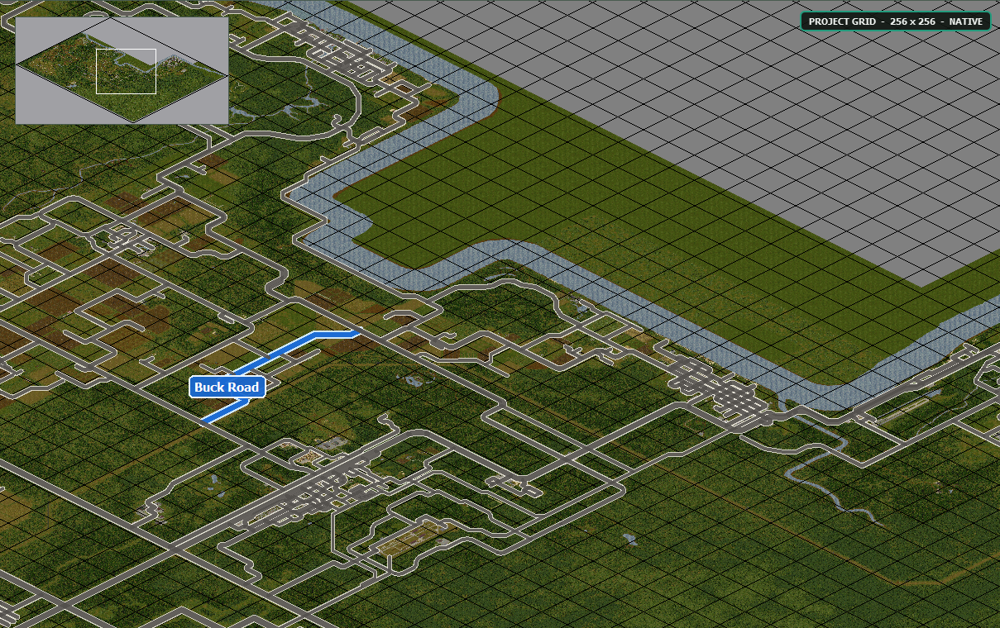

# PZTools Unofficial

Build maps for Project Zomboid with **WorldEd**, **TileZed**, and **BuildingEd**.
This community-maintained Windows x64 edition supports Build 42, basements,
legacy 300 × 300 cells, and native 256 × 256 cells.

[Download for Windows](https://github.com/Unjammer/PZ_Mapping_Tools/releases/latest) · [Release notes](RELEASE_CHANGELOG.md) · [Documentation](DOCUMENTATION.md)

## Included applications

| Editor | What you can do |
| --- | --- |
| [WorldEd](docs/Feature-Reference.md#pzworlded) | Lay out a world in a `.pzw` project, place buildings and zones, preview selected cells in the game, and generate lots. |
| [TileZed](docs/Feature-Reference.md#tilezed) | Paint terrain and tile layers in `.tmx` maps, build Automapper rules, and edit the properties of custom tiles. |
| [BuildingEd](docs/Feature-Reference.md#buildinged) | Build a `.tbx` one floor at a time, from basements to roofs. Draw rooms, place furniture, and paint individual tiles. |

## First setup

1. Download the Windows release and the matching tilesheets linked on its release page. Extract the tools to a writable folder and open an editor from `bin`.
2. In **Initial Setup**, select the mapping **Tiles** folder containing your PNG sheets. Select the supplied `config` folder if the editor asks for it.
3. If you use the game's TileDefs, texture packs, or WorldGen data, select your Project Zomboid installation in **Preferences**.

The game installation and the mapping Tiles folder are separate inputs. The
release includes the editors and their configuration. You supply the game assets.

## Guides and support

- **Editing a map or building** · [Feature reference](docs/Feature-Reference.md) · [Offline user guide](docs/TileZed/PZToolsGuide.html)
- **Working with custom tiles** · [TileDef properties and cleanup](docs/PZ-TileDef-Comparator-and-Snow-Editor.md) · [TileSetZ](docs/TileSetZ.md)
- **Troubleshooting** · [FAQ](docs/FAQ.md) · [Finding the right log](docs/Diagnostics-and-Logs.md) · [Report an issue](https://github.com/Unjammer/PZ_Mapping_Tools/issues)
- **Building from source** · [Windows build instructions](BUILDING.md)

## Why do unofficial mapping tools exist?

Public source does not automatically provide a usable current release. The
mapping community has repeatedly needed matching executables, configuration,
Tiles support, documentation, and corrections before complete official tools
were available. Community maintenance made current Build 42 formats usable by
active mappers and preserved workflows for long-lived projects.

This project exists to keep those tools practical, understandable, and
available. It remains open source so anyone can inspect it, improve it, or
maintain another build.

You're welcome. It was my pleasure.

## Credits and special thanks

- **Tim Baker** for the original [WorldEd](https://github.com/timbaker/pzworlded) and [TileZed](https://github.com/timbaker/tiled) tools. BuildingEd is part of the TileZed source tree.
- The map-style import workflow used the [Google Maps Styling Wizard](https://mapstyle.withgoogle.com/) and custom JSON by 2023. **SadPeanut / [Pz-RealLifeMap](https://github.com/SadPeanut/Pz-RealLifeMap)** contributed the idea of using OpenStreetMap.
- A very special thank you to **Fred 'Military Surplus' Cooper**.
- **Petro**, **Pabbiqo [pq]**, **Dane**, **! Cacador**, **Kyber**, **shakaloblok**, **shisan-233**, and the Project Zomboid mapping and modding community for reports, maps, screenshots, and feedback.

## Licenses and assets

PZWorldEd, TileZed, and BuildingEd are modified GPL applications. This is
an unofficial community release. Use game assets from an authorized
installation and follow the game's modding and
redistribution rules.

[Authors](AUTHORS.txt) · [Feature provenance](FEATURE_PROVENANCE.md) · [Upstream history](UPSTREAM-HISTORY.md) · [Third-party notices](THIRD_PARTY_NOTICES.txt) · [Corresponding source](SOURCE-OFFER.txt)

If you maintain a fork, see [Forks and redistribution](UPSTREAM-HISTORY.md#forks-and-redistribution).
