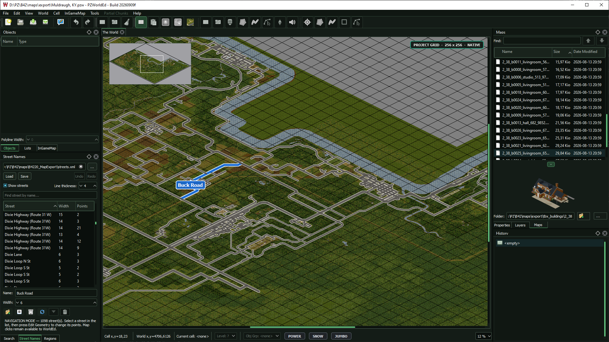

# PZTools Unofficial

PZTools Unofficial is a maintained Qt edition of the Project Zomboid mapping
tools. It includes **PZWorldEd**, **TileZed**, and **BuildingEd**.

The project continues the work in Tim Baker's
[pzworlded](https://github.com/timbaker/pzworlded) and
[tiled](https://github.com/timbaker/tiled) repositories. It preserves basement
and negative-level support and adds current Build 42 mapping workflows,
portable configuration, native 256-cell support, image editing, mapping
automation, compatibility corrections, and safer project maintenance.
Malformed project references and thumbnail cache metadata are validated before
they can reach editor containers or be reused as valid cached data.
TMX maps and tile layers are limited to 300 x 300 tiles, including Native256
workflows that reuse legacy-size maps or building layouts. TileZed asks for
confirmation before a map resize crops existing content.

Tim Baker created the original WorldEd and TileZed foundation. The current
unofficial Qt 5 continuation, maintenance, new features, and fixes are developed
by **Alree / Unjammer**, except where a change has another explicitly recorded
provenance.

This is a community project. It is not an official The Indie Stone release.
Project Zomboid game assets are not included.

- [Current release changes](RELEASE_CHANGELOG.md)
- [Documentation](DOCUMENTATION.md)
- [Troubleshooting FAQ](docs/FAQ.md)
- [Feature reference](docs/Feature-Reference.md)
- [Feature provenance](FEATURE_PROVENANCE.md)
- [Upstream history](UPSTREAM-HISTORY.md)
- [Build instructions](BUILDING.md)



## Included applications

Each main application window includes a lower-right message indicator modeled
after Project Zomboid's error counter. A red box counts errors and an orange
box counts warnings. A new message slides the indicator above the application
status area, keeps it visible for three seconds, then hides it without
discarding the message list. This includes messages emitted by background
workers and warnings that previously appeared only in the log. Warning and
critical message boxes are included as well, without counting the same message
twice when it was just logged. Click a visible box to inspect the complete
timestamped message, source and thread, copy one or all entries, open the logs
folder, filter by severity, or clear the current counters.

The title of each main application window displays the current centralized
build identifier so screenshots and reports can identify the exact binary in
use.

The complete tileset catalogue shares the immutable pixel storage of exact
duplicate extracted tile images within each application process. Sheet names,
tile ordering, IDs, offsets, transparent tiles, and TMX declarations remain
independent and unchanged.

### PZWorldEd

PZWorldEd manages PZW projects, cells, lots, roads, zones, world-map data,
terrain images, Biomemap data, Zombie Heatmaps, WorldGen definitions, OSM
terrain imports, and LOT generation.

Important additions include:

- Native256 projects with one source cell mapped to one output cell
- Partial Chunks mode for selecting the 8 x 8-square chunks included in a
  Native256 LOT export
- Per-cell Native256 chunk-data overrides that paint explicit collision,
  wall-edge, water, and room metadata before LOT export
- BMP-to-TMX validation, optional repair, and Rules/Blends metadata-only synchronization
- Hole Detection based on actual tile presence
- Optional hole filling during LOT generation
- Generate Lots path choosers update the displayed history entry and active
  export setting immediately after the first selection
- Project Doctor for paths, missing tilesets, and project cleanup
- Build 42.20 Biomemap reference and separate red and green painting modes
- Main, vegetation, and Biomemap editing require a saved PZW and use the
  project directory for generated images
- Main terrain, vegetation, and Zombie Heatmap editing accepts PNG and BMP.
  Saving preserves the selected extension and writes matching PNG or BMP file
  data. Attached terrain images refresh in the World view after saving.
- The Maps browser sorts directories and files by Name, numeric Size, or
  actual Last modified time when its column headers are clicked.
- WorldGen biome, feature, and static-prefab editing
- OpenStreetMap project generation with terrain, vegetation, buildings,
  streets, roads, markings, and typed zones
- Regions and Street Names editors
- Native256 `spawnpoints.lua` output with absolute `posX`, `posY`, and `posZ`
  values instead of the historical 300-square `worldX` and `worldY` format
- Creation defaults and non-blocking export validation for SpawnPoint,
  WaterFlow, WaterZone, and RoomTone objects
- A right-click guided property editor for WaterFlow, WaterZone, RoomTone,
  SpawnPoint, ParkingStall, Vehicle, Mannequin, Animal, Basement, and WorldGen
  objects. It is available with both Select and Create Object, targets only
  the zone geometry directly under the pointer, and shows the fields expected
  for that type through enum lists, profession checklists, booleans, and
  numeric controls. Closing the context menu performs no action. The complete
  Properties dock remains available unchanged.
- Moving selected cells also translates Street points, Region anchors, Road
  endpoints, and fully covered terrain-image placements in the same Undo
  transaction
- Cell Move, Copy, Paste, Undo, and Redo preserve the complete cell payload,
  including maps, lots, cell and object properties, notes, templates, zone
  geometry, visibility, polyline widths, and InGameMap features. Ctrl+V and
  **Edit > Paste** both start the same pointer-following preview. Empty targets
  use a green outline and occupied targets use orange. One click pastes into
  the cell under the pointer and returns to the normal selection tool. Pasting
  into a non-empty cell requires explicit confirmation.
- Cell Paste updates its preview only when the target cell changes and reuses
  precomputed relative cell offsets, so pointer movement inside one cell does
  not revisit the clipboard contents.
- Partial Chunks lassos and the optional room-under-pointer highlight redraw
  only the scene regions whose visual state changed. Render diagnostics are
  disabled by default, and rendered-tile counting remains inactive until the
  diagnostics are explicitly enabled.
- Raster rendering does not retain a CPU atlas for every tilesheet. OpenGL
  atlases are assembled only for sheets that are actually uploaded, then the
  temporary CPU atlas is released after upload.
- Project thumbnails are owned by the open PZW documents that use them. When
  the final project closes, unused thumbnail images and every loaded TMX map
  with zero references are released immediately. The complete global tileset
  catalogue remains resident for deterministic legacy-map compatibility.
- InGameMap Forest export with the Forest pyramid and strict Build 42.20
  binary-header validation before existing files are replaced
- InGameMap building outlines from both placed TBX lots and RoomDefs embedded
  directly in cell TMX maps
- InGameMap road generation with generic dirt-to-Trail inference disabled by
  default and available as an explicit preference when a project uses those
  tiles exclusively as paths. Generated road masks close isolated one-tile
  breaks, fill small enclosed holes, discard short internal fragments, and
  retain long or cell-crossing sections before polygon conversion
- Feature Generation preferences provide editable exact-tile catalogues for
  trees and primary, secondary, and tertiary roads. The Tree defaults include
  classic vegetation trees, `jumbo_tree_01_0`, and the Build 42 Jumbo, XL, and
  XXL tree tiles. Clearing a catalogue disables that detection.
- Non-destructive `worldmap.xml` and `worldmap-forest.xml` overlays in the
  World view
- Structured editing of Build 42.20 `worldmap-annotations.lua` text symbols
  from the first entry in **InGameMap**, the annotation button on the main
  toolbar, or **Ctrl+Alt+A**
- Basement entrance placement preview and visual access picker
- Right-clicking a TBX building lot opens it directly in BuildingEd. An
  already-running BuildingEd window receives the selected building instead of
  starting another editor instance.
- Confirmed vertical building-lot placement with source and resulting world
  level ranges, selected underground outlines, and a confirmed ground-opening
  action for basement stairs
- Linked World Projects manager for adding, validating, ordering, replacing,
  and removing read-only PZW references without editing project XML
- Cell View vehicle previews using the game installation's textured 3D meshes,
  scripted dimensions, model scale, model offset, and wheel placement for
  ParkingStall and TrafficJam zones, with a persistent mapping-tools atlas for
  fast reuse across sessions

### TileZed

TileZed edits TMX maps, terrain layers, objects, RoomDefs, TileDefs, depth
geometry, Automapper rules, procedural loot, and texture packs.

Important additions include:

- Complete recursive tileset discovery with 2x, 1x, and custom sources
- Dockable BMP and Brush windows with saved placement
- Rules and Blends replacement for older embedded TMX snapshots
- Indexed Rules and Blends brush updates with sparse dirty-region processing
- Exact rule-tile resolution when similarly named custom or test sheets exist
- Safe, undoable tileset removal with MiniMap synchronization and automatic
  Rules and Blends layer rebuilding
- Layer-aware and floor-aware tile selection
- Copy captures the selected layers and levels. Cut captures and removes them.
  Neither command starts placement. Ctrl+V activates a translucent
  pointer-following preview, then one click places the complete selection.
- Stamp and Fill previews retain their tilesets until the preview is replaced
  or cleared, including when Undo removes a newly introduced tileset from the
  TMX.
- Partial Chunks mode shared with WorldEd for Native256 TMX maps
- Edge, Fence, and Curb previews ignore pointer movement that does not change
  the effective tile, orientation, level, layer, selection, mode, or modifier.
  Their resolved definition tiles are cached for the complete preview and are
  invalidated by real map, layer, configuration, and tileset changes.
- Partial Chunks lassos redraw only changed chunks. Tile edits use the affected
  layer's sprite margins, and BMP edits use the generated BMP layers rather
  than the map-wide maximum, so unrelated Jumbo tiles do not enlarge ordinary
  dirty regions.
- Depth Map primitive editing with Build 42 local geometry dimensions,
  projected outline dimensions, movable saved panels, and reusable presets
- TileDef comparison and Snow, Burnt, and custom replacement editing
- A tileset tile's context menu resolves the configured `.tiles` or
  `.tiles.txt` file that defines it, opens that file in the TileDefs editor,
  and selects the exact tileset and tile index
- Fast pack extraction for individual tiles, tilesets, and multi-tile objects
- Optional orphan-pixel cleanup during extraction
- Lua mapping tools with transactional Undo
- BuildingEd actions and TBX opening launch the standalone `BuildingEd`
  process. TileZed does not host a second embedded editor.
- Narrow Tilesets docks retain every command through the toolbar overflow
  menu.
- Layer and level visibility thresholds are restored from the portable INI.
- The Layers and Levels visibility sliders stay synchronized, clamp stored
  values to the open map, and provide **Check All** and **Uncheck All** from
  the Layers list context menu.
- Bracket-key shortcuts are stored without being mistaken for configuration
  lists. Older shortcut files that lost the default **Decrease BMP Brush
  Size** `[` binding restore it automatically.
- The Maps browser sorts directories and files by Name, numeric Size, or
  actual Last modified time when its column headers are clicked.
- The Qt raster viewport is used consistently. The experimental OpenGL
  viewport is disabled to avoid driver-dependent Brush Tool slowdowns. Render
  diagnostics are disabled by default.

### BuildingEd

BuildingEd creates and edits TBX buildings, rooms, floors, walls, roofs,
objects, furniture, basements, and negative levels.

TBX is an optional authoring and reuse format. A valid TMX can contain its
buildings and all placed tiles directly without retaining separate TBX files.

Important additions include:

- Complete tileset discovery shared with TileZed and WorldEd
- Layer-aware and floor-aware tile selection
- Copy and cut preserve RoomDefs and room layouts together with selected tile
  layers. Cut removes room layouts only when **All Layers** is selected.
  **Current Layer**, **Visible Layers**, and **Specific Layers** remove only
  their selected explicit tile layers. Paste without a destination selection
  provides a translucent, click-to-place preview in the Ortho and isometric
  views.
- Copied RoomDefs are recreated as building-owned rooms during placement, so
  replacing the clipboard cannot invalidate pasted room floors.
- The placement preview uses a validated, immutable snapshot of copied tiles
  and rooms instead of traversing live clipboard grids on every mouse move.
  Converted isometric preview tiles are reused while the pointer moves.
- Tile previews redraw only their affected isometric area. Extended margins
  are applied only to Jumbo, Jumbo XL, and Jumbo XXL tiles, and preview tile
  lookup no longer rebuilds the complete tileset catalogue on each move.
- The Qt raster viewport uses minimal dirty-region updates. The experimental
  OpenGL viewport is disabled, and render diagnostics are off by default.
- Structural edits regenerate automatic building layers only for the visible
  Object, Tile, or Attribute mode. Hidden isometric views synchronize when
  their mode is opened instead of repeating the same floor-wide work after
  every room, wall, window, door, stair, roof, or furniture change.
- Placement previews and object dragging update only the temporary structural
  plan. Committed object and room edits regenerate automatic layers around the
  affected cells, including the floor above for stairs and similar objects.
  An object committed from its active preview reuses that prepared temporary
  structure.
- Switching between Iso, Tiles, and Attributes repaints the current level as
  soon as the destination mode becomes visible, including buildings without
  rooms.
- A running BuildingEd instance receives TBX files opened from PZWorldEd,
  TileZed, Explorer, or another BuildingEd launch.
- Closing a TBX releases its building model and all per-document editor views
  so closed buildings do not accumulate during a long session.
- TBX tile definitions replaced by matching catalogue entries remain valid for
  the lifetime of the building, preventing stale references while automatic
  layers and the preview map are constructed.
- Older TBX tile entries are expanded to the current category layout during
  loading. Stair objects with an empty tile entry remain valid and no longer
  crash automatic-layer or welcome-thumbnail rendering.
- Room tile actions require a valid selected tile row. Clear, Random, and
  Choose remain disabled when only a room row is selected.
- Editing a room name or internal name commits when the field is finished or a
  list entry is selected. Text entry no longer rebuilds every isometric floor
  after each character.
- Buildings are limited to 300 x 300 tiles during creation, loading, and
  resizing. A resize that would crop content requires confirmation.
- Pasting beyond an edge expands the building up to that limit while preserving
  and shifting existing rooms, user tiles, square properties, objects, and
  basement access. A paste that would exceed the limit requires confirmation
  and crops only clipboard content outside the building bounds. One Undo
  restores the complete pre-paste state.
- Copy checkpoints the recoverable autosave when the document already contains
  unsaved changes. Timed autosave remains paused while a cut or paste
  transaction is incomplete and resumes only after the coherent final state is
  available.
- Preserved room-floor definitions across save and reopen
- Procedural-loot inspection and project overrides
- Lua building automation with transactional Undo
- Configurable autosave at 1, 5, 10, 20, or 60 minutes
- The Layers visibility threshold is restored from the portable INI.

## First setup

1. Extract the release to a writable directory.
2. Start any of the three applications.
3. Select the mapping **Tiles** directory that contains the PNG sheets.
4. Select the packaged `config` directory if it was not found automatically.
5. Optionally select the Project Zomboid installation in Preferences.

The shared Project Zomboid path can supply official TileDefs, texture packs,
WorldGen data, procedural-loot definitions, and vehicle preview assets. It does
not replace the extracted mapping Tiles directory required by the renderers.

## Cell View vehicle previews

Set the Project Zomboid installation path in WorldEd Preferences, open a cell,
then enable **View > Show Vehicle Mesh Previews**. WorldEd displays textured
vehicles on ParkingStall vehicle zones and on rectangular or polyline
TrafficJam variants. `Nav` and other navigation zones are not vehicle zones and
do not receive a preview.

Vehicle display size, render quality, atlas status, and atlas rebuilding are
grouped in the separate **Preferences > Vehicles** tab.

The preview reads the installed vehicle scripts, `VehicleZoneDefinition.lua`,
textures, legacy text meshes, and binary FBX meshes. The zone name selects its
actual vehicle category, so Police, Fire, Ranger, Ambulance, Junkyard,
TrafficJam, and ordinary ParkingStall zones use their own distributions. The
default spawn rate and the normal, special, and burnt-vehicle chances determine
whether a vehicle appears and which distribution supplies it. Shared and
aliased Lua distributions retain their configured weights.

The ordinary installed `ParkingStall` distribution is intentionally sparse.
Several nearby stalls can therefore display no vehicle while other parts of
the same cell do. This is a deterministic preview of the configured spawn
density, not an atlas-loading failure.

Vehicle type, game-scale dimensions, scripted `randomAngle`, `Direction`,
`FaceDirection`, stall spacing, TrafficJam lane direction, and TrafficJam angle
variation are used to create a deterministic editing preview. Each zone and
position receives a stable result, so representative density, category, model,
and orientation do not change on every repaint. The renderer preserves the
resource-model scale, vehicle-model scale, and vehicle-model offset instead of
stretching every body independently to its physics extents. It attaches the
installed wheel mesh at each scripted wheel position and applies the same model
offset, scale, and ground alignment to the complete assembly. Named bodies are
selected correctly from FBX files containing multiple geometries.

WorldEd checks its persistent vehicle atlas before calculating a mesh preview.
Each cached sprite contains the selected body, texture, linked wheels, render
quality, and direction. The atlas supports 16 directions and is stored below
`settings/cache/vehicle-preview-atlas` in the mapping-tools installation. Its
asset fingerprint covers the relevant game scripts, models, and textures, so a
changed game installation creates a separate valid cache instead of reusing
stale images. WorldEd never writes the cache into the game installation.

**Preferences > Vehicle Previews > Preview size** controls a display correction
from 0.25 x to 4 x in 0.25 steps. The default is 1 x, which represents the
dimensions calculated from the installed vehicle script and model resource.
Changing this display-only value keeps the vehicle centered on its actual zone
anchor.
**Preferences > Vehicle Previews > Render quality** controls the internally
calculated image resolution from 0.25 x to 4 x. It changes sharpness, memory
use, and calculation time without changing the displayed size or zone anchor.
The default is 2.5 x, while lower values reduce memory use and calculation time.
When preview size exceeds render quality, WorldEd automatically uses the
preview size as the effective atlas quality so an undersized sprite is never
enlarged into a blurry result.
The same group reports the atlas state for the selected game installation and
quality. **Rebuild Atlas** clears only that matching cache and precomputes all
16 directions for every vehicle used by the installed zone definitions. An
existing eight-direction cache remains usable through the nearest stored
orientation until it is rebuilt.
A cancelled rebuild keeps the completed sprites, so later previews can reuse
them.
The game can still omit vehicles or vary their exact position, angle, skin,
damage, and density at runtime because those results depend on sandbox settings
and random spawning. The preview does not change the PZW, TMX, zone
definitions, or game files. No game asset is copied into the mapping tools
distribution.

Vertical Placement is available from the context menu of a selected building
lot. The menu shows the source level range stored by the TBX or TMX and the
current resulting world range. Lowering, raising, or returning a lot to level
0 requires confirmation and previews the resulting range before the project is
changed. The operation shifts the complete source uniformly, including floors,
walls, windows, stairs, RoomDefs, objects, and collision layers. A source that
already stores its basement on negative levels normally remains at lot level 0.
Dragging a lot into another level group in the Lots panel requires the same
explicit confirmation, while reordering lots within their current level does
not. LOT generation records every nonzero vertical placement and its source and
world level ranges in the application log. Generation stops if a manual project
edit would place content outside the supported world levels.

Basement access resources use the portable directory beside `bin`:

- `pzby_tbx/basement_access` for editable TBX and TMX sources
- `pzby_tbx/binmap` for compiled PZBY files

WorldEd searches both portable resource directories recursively and detects
files added while the application is running. A basement-access source does
not need to contain a staircase or a dedicated anchor. WorldEd displays the
complete TBX or TMX as a translucent overlay aligned to the Basement trace
origin. The source is loaded only when its Basement object is selected, so
opening a cell does not load every access used by that cell. Right-click the
Basement zone itself with Select or Create Object and choose **Choose Basement
Access...** to browse the available access names with a visual preview. This
action is never offered for another zone type.

Each application provides an autosave interval in Preferences. WorldEd and
TileZed save only an existing modified PZW or TMX. BuildingEd retains its
recoverable `.autosave` copy workflow. Untitled projects are never assigned a
path automatically. Copy checkpoints autosave when unsaved edits exist.
Autosave pauses during complete cut, paste, paint, and resize transactions and
resumes only after the document is coherent.

## Spawn points and Lua zone export

WorldEd stores each SpawnPoint in its source cell with local coordinates. When
it writes `spawnpoints.lua`, it adds the configured World origin, multiplies
the resulting cell coordinate by the project cell size, and adds the local
position. A Native256 point at cell `17,54` and local position `31,123` is
therefore written as `{ posX = 4383, posY = 13947, posZ = 0 }`.

The generated file keeps the existing `SpawnPoints()` function, profession
tables, point lists, and `posZ`. It no longer writes `worldX` or `worldY`.
WorldEd shows the same absolute coordinates in the visible SpawnPoint label.

New SpawnPoints default to the explicit `unemployed` profession. New
WaterFlow objects default to a 1 x 1 rectangle with `WaterDirection = 0` and
`WaterSpeed = 0.0`. New WaterZones receive `WaterGround = false` and
`WaterShore = true` without reducing a valid larger water area. New RoomTone
objects default to a 1 x 1 rectangle with `RoomTone = Generic` and
`EntireBuilding = false`.

Lua export omits an invalid SpawnPoint, WaterFlow, WaterZone, or RoomTone
record and lists the exact reason. The object remains in the PZW for repair,
the project remains saved, and LOT generation remains available. Correct the
reported geometry or properties and save or export again to include it.

## Partial chunk LOT export

Native256 maps can use **Partial Chunks** when a cell should contain only a
small building, zone, or playable area. Open the cell TMX in TileZed or open
the WorldEd cell view, then use the dedicated **Partial Chunks** menu or
toolbar. The 256 x 256 cell remains the normal editing canvas while a 32 x 32
chunk grid shows the export mask.

Each grid square represents one complete 8 x 8-square game chunk. Click a
chunk to toggle it. Drag across the grid to select or clear a rectangular
group. The state of the starting chunk determines whether the dragged group
is included or omitted, and the overlay previews the result until release.
Included chunks use a light tint and omitted chunks are darkened. **Ctrl+A**
or **Select All Chunks** includes all 1024 chunks while the mode is active.
**Clear Chunk Selection** omits all of them. These actions select export
coverage, not the tiles inside the TMX, and do not delete or rewrite source
layers. The grid line and included-chunk tint use the existing **Grid color**
from Preferences, so WorldEd and TileZed can each display the mask in a
user-selected color.

**How Partial Chunks Works...** in either Partial Chunks menu shows the same
workflow and export rules inside the application. Disable the mode while
performing normal tile or object editing, then re-enable it before partial LOT
generation. The saved chunk choices are retained while the mode is disabled.

The selection is stored beside the TMX as `map-name.tmx.pzchunks`. Keep this file
with the TMX when moving or sharing the source project. A map without an
enabled sidecar retains conventional whole-cell behavior.

While Partial Chunks is enabled, Hole Detection and automatic hole filling
are disabled for that cell. Generate Lots writes selected chunks normally and
encodes omitted chunks as absent LOT data and null navigation chunks. RoomDefs,
room objects, used-tile headers, and zombie intensity are limited to the
selected chunks. A selected chunk may be empty by design. An omitted chunk is
absent from the exported LOT even if its TMX area contains tiles. This mode is
available only for Native256 projects.

## Native256 chunk-data overrides

Select one cell in a Native256 project, then open **Tools > Terrain &
Environment > Native256 Chunk Data Overrides**. The editor stores one optional
256 x 256 RGBA PNG for that cell. One image pixel represents one map square.
Transparent pixels keep the value that WorldEd normally generates from the
TMX, TBX, rooms, and tile definitions. Opaque pixels replace that generated
value. The red channel contains a value from 0 through 31. Green and blue must
be zero. Right-drag restores transparent automatic generation.

The PZW stores the PNG reference on the cell. Cell Move, Copy, Paste, Undo,
and Redo preserve that reference. Generate Lots validates every attached PNG
before starting and stops with the affected cell and reason if a file is
missing, unreadable, the wrong size, or contains unsupported channel values.
Legacy300 projects cannot attach or export this data.

Build 42.20.3 `MapCollisionData` defines five flags for each level-0 square:

- `0` means none of the five flags is set. An explicit opaque zero can turn a
  normally generated square into empty collision metadata.
- `1`, Solid, marks the complete square as solid in native collision and path
  data. The game normally derives it from a solid or solid-transparent square
  or from stairs, then removes it for water and tree squares.
- `2`, North wall, blocks the north edge. The game normally derives it from
  north collision, north door frames or door walls, and north window flags.
  A hoppable north edge is not marked blocked.
- `4`, West wall, applies the equivalent rule to the west edge using the west
  collision, door, window, and hoppable flags.
- `8`, Water, marks the square as water in native collision data.
- `16`, Room, marks the square as belonging to a room.

Flags combine by addition. For example, `17` is Solid plus Room, and `22` is
North wall plus West wall plus Room. The tool permits every combination from
0 through 31 without claiming that every combination is sensible for the
game. Use the smallest combination required for the intended test.

The game passes each `chunkdata_x_y.bin` file to the native collision system
when it initializes a meta cell in single-player or on a server. It does not
initialize this system on a game client. Native path tasks consume this data.
When an actual 8 x 8 chunk later loads or a level-0 square changes, the game
recalculates these same five bits from the real square. The override therefore
controls the generated initial metadata. It does not alter the TMX, tiles,
TileDefs, or the loaded square itself.

WorldEd still has an internal null or absent marker used by Partial Chunks and
empty source coverage. The editor intentionally does not expose it because it
is outside the five values visible in `MapCollisionData`. Leave a pixel
transparent when WorldEd should retain its normal null or generated state.
An omitted Partial Chunk remains absent and takes priority over override
pixels inside that chunk.

In **Preferences > Window Setup**, **Use 1920 x 1080** immediately resizes and
centers only the current application. **Apply to Current Application** does the
same with the entered custom dimensions. **Apply to All Three Applications**
also starts the other two tools with that size. These actions are temporary and
the previous saved layouts return on the next normal start.

## World-map XML overlays

Open **View > World Map Overlays** to load `worldmap.xml` or
`worldmap-forest.xml` over the World view without importing their features
into the PZW. Loading `worldmap.xml` also loads an adjacent
`worldmap-forest.xml` when present. The two overlays can then be shown,
hidden, or cleared independently. Forest geometry is green. Buildings, water,
roads, railways, and other world-map geometry use distinct colors. Loaded
overlays are read-only and never change project data or exported files. The
overlay renderer spatially batches geometry and skips batches outside the
visible World view. Build 42.20 world-map files always use 256-square cells.
WorldEd therefore places overlay geometry from absolute map-square
coordinates, independently of whether the open project uses Native256 or
Legacy300 cells. Newly written XML includes `cellSize="256"`. Older XML
without this attribute defaults to the Build 42.20 grid, while clear legacy
300-square geometry is detected when local coordinates exceed 256.

**Write Worldmap** and **Write Worldmap-Forest** now normalize both the XML
and binary outputs to the Build 42.20 256-square grid. Legacy300 project
features that cross a 256-square boundary are split into the required output
cells without changing their absolute map-square position. Native256 projects
remain one-to-one.

World-map export also accounts for every expanded road polygon triangulated by
the Build 42 renderer. A cell that would exceed the renderer's signed 16-bit
index position is simplified conservatively. If simplification alone is not
enough, only the smallest internal road fragments required to make the export
safe are omitted from XML and binary output. The PZW source features are never
changed, and the portable log identifies every affected cell and road class.

**InGameMap > Generate Building Features** detects placed TBX lots and
RoomDefs embedded directly in assigned cell TMX maps. Room rectangles are
merged into building outlines. Disconnected footprints remain separate and
negative basement levels are excluded from the surface outline.

**InGameMap > Create World Image** uses the packaged `MapToPNG.txt` color
rules. This file is different from terrain `Rules.txt`. The dialog selects the
packaged file by default and replaces an invalid remembered rules path.

## Linked World Projects

Open **World > Linked World Projects...** to manage the PZW files historically
stored as `otherworld` XML entries. The manager reports each linked project's
path, grid format, World origin, size, relative placement, coverage, overlap,
and validation status. It prevents self-links, duplicates, unreadable files,
and mixed 256 or 300 cell grids. Existing broken entries remain visible for
replacement or removal.

Linked projects are read-only visual references. They are not merged into the
current PZW and their content is not exported by Generate Lots. Their position
is the linked World origin minus the current World origin. Open and save a
linked project to change that origin, then use **Refresh** in the manager.
Changes to the list support Undo and are saved through the normal PZW workflow.
Use **View > Show Linked World Projects** for visibility.

See the [Linked World Projects guide](docs/PZWorldEd-Linked-World-Projects.md)
for the complete workflow and PZW compatibility details.

## Tileset compatibility

All three applications discover valid PNG sheets recursively.

1. A readable 2x sheet is preferred.
2. A readable 1x or custom sheet is used when no 2x sheet exists.
3. A missing placeholder is used only when neither scale resolves.
4. One-scale-only sheets remain valid.
5. Nested official pack directories and custom directories are supported.

TMX files retain their complete ordered tileset headers. This is required for
older maps, adjacent cells with different `firstgid` values, and embedded BMP
rules that reference tiles not currently painted on a normal tile layer.

A fully transparent cell in a resolved sheet is valid and remains distinct
from a missing PNG. BuildingEd tile, furniture, mixed-tileset, and Building >
Tiles browsers display transparent and explicitly invisible tiles with a
crossed-eye marker. Unresolved sources use a separate red missing-source
marker. Tile makers should assign the `invisible` TileDef property to
intentional transparent placeholders so Check Maps can distinguish them from
accidental empty artwork.

## Portable configuration

The Windows release keeps its writable state inside the extracted directory:

```text
PZTools-Qt5-Latest/
|-- bin/
|-- brushes/
|-- config/
|-- docs/
|-- licenses/
|-- lua/
|-- plugins/
|-- settings/
|-- themes/
`-- translations/
```

Preferences and logs are stored under `settings`. Logs include OS, CPU, RAM,
display-adapter, Qt, and process information useful for support without
recording a username, hostname, serial number, IP address, or stable machine
identifier.

WorldEd reloads the tileset catalogue only when the effective Tiles directory
changes. Confirming other Preferences does not rebuild open maps or lots.

Packaged themes are refreshed automatically when the release provides a newer
QSS definition. Built-in dark and colored themes also apply matching Qt
palette colors to application-drawn text, menus, selections, and tooltips.
BuildingEd welcome content, tileset lists, editable zoom controls, and tile
preview canvases follow the active dark palette unless the user selected a
custom tile-preview background color. High-contrast SVG artwork is used for
tools whose original black silhouettes were unreadable on dark backgrounds.
Additional QSS files placed in `themes` remain user-managed and are not
overwritten.

## Project safety

Guided repair and conversion tools show their inputs and outputs before
writing. Project Doctor begins with a read-only check. Destructive project
corrections create backups and use atomic file replacement where supported.
TMX tileset use is verified from raw GIDs even when a referenced PNG is
missing. TBX inspection is diagnostic only and never rewrites a building.
Game installation data is treated as a read-only source. Project overrides
belong in the mapper's project or mod directory.

## Why do unofficial mapping tools exist?

Public source does not automatically provide a usable current release. The
mapping community has repeatedly needed matching executables, configuration,
Tiles support, documentation, and corrections before complete official tools
were available. Community maintenance made current Build 42 formats usable by
active mappers and preserved workflows for long-lived projects.

This project exists to keep those tools practical, understandable, and
available. It remains open source so anyone can inspect it, improve it, or
maintain another build.

You're welcome. It was my pleasure.

## Documentation and issue reports

- [Documentation index](DOCUMENTATION.md)
- [Offline documentation home](docs/index.html)
- [Feature reference](docs/Feature-Reference.md)
- [Configuration files](docs/PZTools-Configuration-Files.md)
- [Project Doctor](docs/PZ-Project-Doctor-Tiles-and-Paths.md)
- [WorldGen editor](docs/PZ-B42.20-WorldGen-Editor-and-Prefabs.md)
- [Procedural loot editor](docs/PZ-B42.20-Procedural-Loot-Editor.md)
- [Pack comparator and extractor](docs/PZ-Pack-Comparator-and-Extractor.md)
- [TileDef tools](docs/PZ-TileDef-Comparator-and-Snow-Editor.md)
- [Logs and issue reports](docs/Diagnostics-and-Logs.md)
- [Feature provenance](FEATURE_PROVENANCE.md)
- [Upstream history](UPSTREAM-HISTORY.md)
- [Current release changes](RELEASE_CHANGELOG.md)

A useful issue report includes the application, release, exact steps, expected
and observed behavior, newest matching log, affected source files when they
can be shared, and a screenshot for visual problems.

## Building from source

The [build guide](BUILDING.md) describes the source layout and compilation for
Windows, Linux, and macOS. Windows x64 with Qt 5.14.2 and MSVC is the current
release target. Other platforms must be compiled with compatible Qt and native
toolchains.

## Credits and special thanks

- **Tim Baker** for the original WorldEd and TileZed work that remains the
  upstream foundation of these tools.
- **Alree / Unjammer** for the unofficial Qt 5 continuation, current
  maintenance, new features, fixes, integrations, and releases.
- The map-style import workflow is documented as existing since at least 2023
  with the [Google Maps Styling Wizard](https://mapstyle.withgoogle.com/) and
  custom JSON. It later evolved toward OpenStreetMap in the native tools.
- **SadPeanut / [Pz-RealLifeMap](https://github.com/SadPeanut/Pz-RealLifeMap)**
  for the idea of using OpenStreetMap instead of Google.
- A very special thank you to **Fred 'Military Surplus' Cooper**.
- **Petro**, **Pabbiqo [pq]**, **Dane**, **! Cacador**, **Kyber**,
  **shakaloblok**, and the Project Zomboid mapping and modding community for
  reproducible reports, project files, screenshots, logs, and practical
  workflow feedback.

Legal authorship and third-party attribution are documented in
`AUTHORS.txt`, `FEATURE_PROVENANCE.md`, `UPSTREAM-HISTORY.md`, and the bundled
license notices.

## Licenses and assets

PZWorldEd, TileZed, and BuildingEd retain their upstream copyright notices and
are distributed as modified GPL applications. `libtiled`, `tmxviewer`, Qt,
and other bundled components retain their own licenses.

The release includes `COPYING.txt`, `THIRD_PARTY_NOTICES.txt`,
`SOURCE-OFFER.txt`, `FEATURE_PROVENANCE.md`, `UPSTREAM-HISTORY.md`, and the complete `licenses`
directory. Corresponding source is published at
<https://github.com/Unjammer/PZ_Mapping_Tools>.

Project Zomboid data, Tiles, textures, and other game assets are not part of
this repository or release. Users must obtain them from an authorized game
installation and follow the game's modding and redistribution rules.
