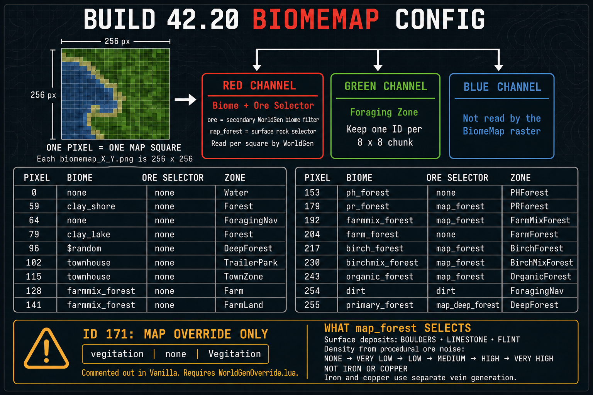

# Project Zomboid 42.22.2 BiomeMapConfig reference



Build 42.22.2 reads two independent IDs from each BiomeMap pixel and looks
them up in `lua/server/metazones/BiomeMapConfig.lua`.

- **Red** selects the `biome` for that map square and its `ore` selector when
  the same entry defines one.
- **Green** selects the `zone` used for foraging.
- **Blue** is ignored by the BiomeMap reader.

In vanilla `biomemap_42_38.png`, pixel `(0, 0)` is `RGB(115, 64, 64)`.
The game reads red 115 as `townhouse` and green 64 as `ForagingNav`. The
blue value 64 has no effect on either lookup. The pixel's displayed RGB color
can look reddish while still carrying a valid green-channel zone ID. Green
0 selects `Water` in the vanilla table.

## What `map_forest` means

`map_forest` is a selector prefix in `worldgen.biomes_map`. It is not an ore
image, an item name, or a request for iron.

The base `map_forest` definition has `generate = false`. WorldGen uses the
prefix to select one generated child definition matching the current
procedural ore-noise band:

- `map_forest_boulder_*` places surface boulder sprites
- `map_forest_limestone_*` places surface limestone sprites
- `map_forest_flint_*` places surface flint sprites

The suffix is selected from `none`, `very_low`, `low`, `medium`, `high`, or
`very_high`. The red Biomemap value selects `map_forest`, but it does not
directly choose the material or density. WorldGen's deterministic selector and
ore noise resolve those details for each coordinate.

| Ore-noise band | Boulders probability | Limestone probability | Flint probability |
|---|---:|---:|---:|
| `NONE` | none | none | none |
| `VERY_LOW` | 0.1% | 0.05% | 0.05% |
| `LOW` | 0.2% | 0.1% | 0.1% |
| `MEDIUM` | 1% | 0.5% | 0.5% |
| `HIGH` | 2% | 1% | 1% |
| `VERY_HIGH` | 4% | 2% | 2% |

These are feature probabilities after WorldGen has selected the matching
material family and density variant. Placement is attempted only on eligible,
otherwise open natural ground. The selector allows
`blends_natural_01_*` with explicit base and edge exclusions and excludes all
`blends_natural_02_*` water tiles.

Iron and copper are not selected by `map_forest`. Build 42.22.2 generates those
through the separate vein definitions in `WorldGen/Veins.lua`.

`map_deep_forest` uses the same boulder, limestone, flint, and density
structure under a separate deep-forest selector prefix.

## Image geometry

The game looks for:

`media/maps/<MapName>/maps/biomemap_<cellX>_<cellY>.png`

Each file is 256 x 256 pixels. One red sample and one green sample describe
each map square in that native cell.

The red channel is evaluated per square by WorldGen. The green channel is read
in 8 x 8 groups on the absolute world grid. Every distinct green ID in a group
contributes to chunk-level foraging-zone generation. The upper-left chunk of
`biomemap_42_38.png` contains green 64 (`ForagingNav`) and 115 (`TownZone`).
WorldEd preserves both when importing the zone channel. Paint one green ID
throughout a chunk when you want a single zone there.

## Verified Build 42.22.2 entries

The 18 active ID definitions match the earlier 42.20 reference. Build
42.22.2 updates the shipped biome raster data. The reference colors below
are shown in the WorldEd palette, and the PNG stores numeric channel values.

| Pixel | WorldEd color | Biome | Ore selector | Zone | Availability |
|---:|---|---|---|---|---|
| 0 | `#008AFF` | none | none | `Water` | Vanilla |
| 59 | `#3B5F3B` | `clay_shore` | none | `Forest` | Vanilla |
| 64 | `#646464` | none | none | `ForagingNav` | Vanilla |
| 79 | `#4F694F` | `clay_lake` | none | `Forest` | Vanilla |
| 96 | `#604623` | `$random` | none | `DeepForest` | Vanilla |
| 102 | `#D2C8A0` | `townhouse` | none | `TrailerPark` | Vanilla |
| 115 | `#A5A08C` | `townhouse` | none | `TownZone` | Vanilla |
| 128 | `#FF8000` | `farmmix_forest` | none | `Farm` | Vanilla |
| 141 | `#784614` | `farmmix_forest` | none | `FarmLand` | Vanilla |
| 153 | `#400000` | `ph_forest` | none | `PHForest` | Vanilla |
| 179 | `#5A2018` | `pr_forest` | `map_forest` | `PRForest` | Vanilla |
| 192 | `#FF00FF` | `farmmix_forest` | `map_forest` | `FarmMixForest` | Vanilla |
| 204 | `#00FF00` | `farm_forest` | none | `FarmForest` | Vanilla |
| 217 | `#C8D9AA` | `birch_forest` | `map_forest` | `BirchForest` | Vanilla |
| 230 | `#96BE82` | `birchmix_forest` | `map_forest` | `BirchMixForest` | Vanilla |
| 243 | `#2D642D` | `organic_forest` | `map_forest` | `OrganicForest` | Vanilla |
| 254 | `#6E5037` | `dirt` | `dirt` | `ForagingNav` | Vanilla |
| 255 | `#7F0000` | `primary_forest` | `map_deep_forest` | `DeepForest` | Vanilla |
| 171 | `#91873C` | `vegitation` | none | `Vegitation` | Map override only |

Values 34, 45, 166, and 171 are commented out in the Vanilla configuration.
They do not become valid merely because they appear in comments. WorldEd keeps
only the already documented ID 171 extension because it has a verified
map-specific override workflow.

## Important special cases

- Red 0 and red 64 have no `biome` or `ore` field. They can define green-zone
  behavior, but their red value does not request a WorldGen biome.
- Red 96 uses `$random`, which delegates the square to the random WorldGen
  path instead of selecting one named map biome.
- Pixel 254 deliberately maps both `biome` and `ore` to `dirt`, while its green
  meaning remains `ForagingNav`.
- Pixel 255 combines `primary_forest`, `map_deep_forest`, and `DeepForest`.
- Pixel 171 is disabled in Vanilla. A map must add it to
  `biome_map_config` through `WorldGenOverride.lua`.

## WorldEd behavior

WorldEd uses this table for the reference, brush, and export.

1. **Generate Biome Map > Show Build 42.22.2 BiomeMapConfig Reference...**
   displays every field and marks override-only values.
2. The Biomemap brush has two explicit modes. **Biome (red channel)** paints
   map-square values and preserves green. **Zone (green channel)** paints
   complete 8 x 8 chunks on the absolute world grid and preserves red. The
   displayed overlay switches to the active channel so Zone strokes remain
   visible while they are edited. Each mode retains its own value and radius.
3. Generation accepts the palette colors and legacy terrain and vegetation
   aliases. Transparent or black vegetation pixels use the terrain beneath
   them. Unmapped colors are reported and use neutral red 64. Legacy grass
   colors select red 171 only when a matching `vegitation` biome entry is
   detected. Otherwise they use neutral red 64 and leave the authored
   terrain without a BiomeMap vegetation request.
4. Generation rejects unknown green IDs. It reports mixed green IDs on the
   absolute world grid and preserves the green values from an external PNG.
   A green 171 value with no detected override produces an explicit warning.
5. Generation writes `biome.png` and native 256 x 256 PNG tiles to the
   chosen directory for both 256 x 256 and legacy 300 x 300 project grids.
   Partial boundary tiles preserve pixels from a valid
   selected base tile or a valid existing output tile. Uncovered pixels
   without a base use red and green 64. The brush reads and writes the native
   tiles alongside the configured project image.

When zones are rasterized from the current PZW project, unpainted terrain has
three fallback choices:

- **Automatic** uses green 171 only when a literal `pixel = 171` entry with
  `zone = "Vegitation"` is detected in the map's `WorldGenOverride.lua`. Otherwise it uses the
  Vanilla-safe green 64 `ForagingNav` value.
- **ForagingNav 64** always uses the Vanilla-safe neutral navigation value.
- **Vegitation 171** always writes green 171 and warns when its map override
  cannot be detected.

WorldEd uses the zone names in the table to rasterize PZW objects. Where two
IDs name the same zone, it uses 59 for `Forest`, 64 for `ForagingNav`, and
255 for `DeepForest`. A project `Vegitation` zone uses green 64 when its
override is absent and green 171 has not been selected explicitly.

An external Zone PNG supplies every green value. Automatic detection reads
literal entries in a `biome_map_config` table or a
`table.insert(biome_map_config, {...})` call. The biome and zone fields are
checked independently. Lua execution and dynamically constructed entries
are resolved by the game.

## Enabling ID 171 for a map

Place this idempotent block in:

`media/maps/<MapName>/WorldGenOverride.lua`

```lua
local hasJumboBiome = false
for _, entry in ipairs(biome_map_config) do
    if entry.pixel == 171 then
        hasJumboBiome = true
        break
    end
end

if not hasJumboBiome then
    table.insert(biome_map_config, {
        pixel = 171,
        biome = "vegitation",
        zone = "Vegitation",
    })
end
```

Painting red ID 171 then selects the verified `vegitation` biome that produces
the deterministic redbud Jumbo XXL feature. Green 171 is only needed when the
same area must also become the `Vegitation` foraging zone.
